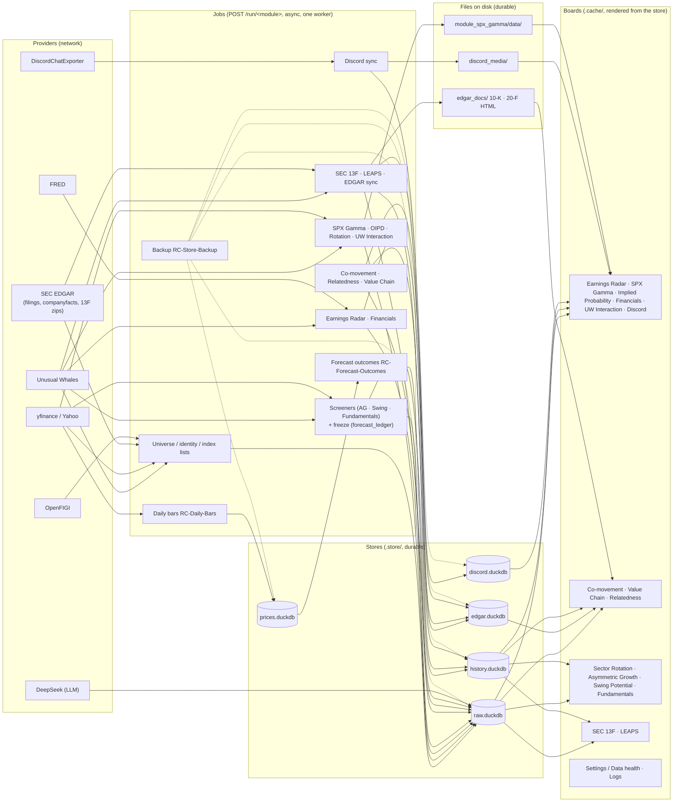

# System map — RevenueChaser

Where each part of the app lives, and how data moves from a provider to a board.
Companions: [`data_architecture.md`](data_architecture.md) for the storage rules
(what is durable and what is regenerable), [`data_retrieval.md`](data_retrieval.md)
for Fetch vs Refresh. Source basis: the current worktree; the stores are the four
files of `docs/data_architecture.md` §Storage layout plus the result history of
`core/history.py`.

This is the **area map** of the epics #49–#60 and #79 (`.hermes/plans_claude/arch/2026-10-02_open_issue_rereview_program.md`),
one line each with the folders it owns.

| Area | Epic | Main folders |
|---|---|---|
| Data store & durability | #49 | `core/rawstore.py`, `core/config.py`, `core/automations.py`, `.store/`, `scripts/backup_store.py` |
| App shell & jobs | #50 | `app/` (`dashboard.py`, `runners.py`, `jobs.py`), `templates/` |
| Data providers & credentials | #51 | `core/providers/`, `core/credentials.py`, `core/offpeak.py` |
| Identity spine & reference data | #52 | `core/identity/` (the single GICS writer since R3), `core/gics_map.py`, `core/universe.py`, `core/universe_fetch.py`, `core/index_registry.py`, `core/taxonomy.py` |
| Settings / Data health | #53 | `module_settings/`, `core/board_settings.py`, `docs/data_health.md` |
| Shared filters & board shell | #54 | `core/reporting_common.py`, `core/html_safe.py`, `core/screen_common.py`, `core/static/` |
| Classification boards | #55 | `module_comovement/`, `module_relatedness/`, `module_value_chain/` |
| Screeners | #56 | `module_asymmetric_growth/`, `module_swing_potential/`, `module_fundamentals/`, `core/ledger.py`, `core/outcomes.py` |
| Market boards | #57 | `module_spx_gamma/`, `module_oipd/`, `module_sector_rotation/`, `module_uw_interaction/`, `module_financials/` |
| Earnings Radar | #58 | `module_earnings_radar/` |
| Ownership | #59 | `module_sec_13f/`, `module_leaps/`, `core/ownership.py`, `edgar_docs/` |
| Quality: testing, e2e, research lane | #60 | `module_testing/`, `core/tests/`, `conftest.py` |
| Community signals (Discord) | #79 | `module_discord/`, `discord.duckdb`, `discord_media/` |

## Data flow: providers → jobs → stores → boards

Providers are reached only by the async jobs behind `POST /run/<module>` (one worker drains the queue; a
Refresh re-reads `.store/` with no network). Each job writes its rows to a store file, and the boards
render from the store. Files on the side (`edgar_docs/`, `discord_media/`, the SPX Gamma tree) hold the
artifacts that are files intrinsically; `.cache/` holds the regenerable board output.

Notes the diagram simplifies:

- **Fetch vs Refresh.** A Fetch runs a job (network) and re-caches the board; a Refresh drops the
  `.cache/` artifact and re-derives the board from `.store/` with no network at all
  (`docs/data_retrieval.md`). The boards above are the `.cache/*_latest.html` artifacts.
- **Result history.** `core/history.record_run` writes one header row and its run-keyed rows to
  `history.duckdb` per run; the "Recorded sessions" block reads them (`core/reporting_common.py`).
  The file appears with the first recorded run.
- **The forecast ledger.** `core/ledger.py` freezes each board's shown picks into
  `raw.duckdb.forecast_ledger` (append-only, `"history": True`, #286); `core/outcomes.py` derives
  `forecast_outcomes` from it and the `prices.duckdb` bars.
- **Credentials and providers.** Provider base URLs are env-overridable and their key messages live in
  `core/credentials.py`; the job queue and its `X-RC-Panel` CSRF rule are in `app/jobs.py` and
  `app/dashboard.py`.
