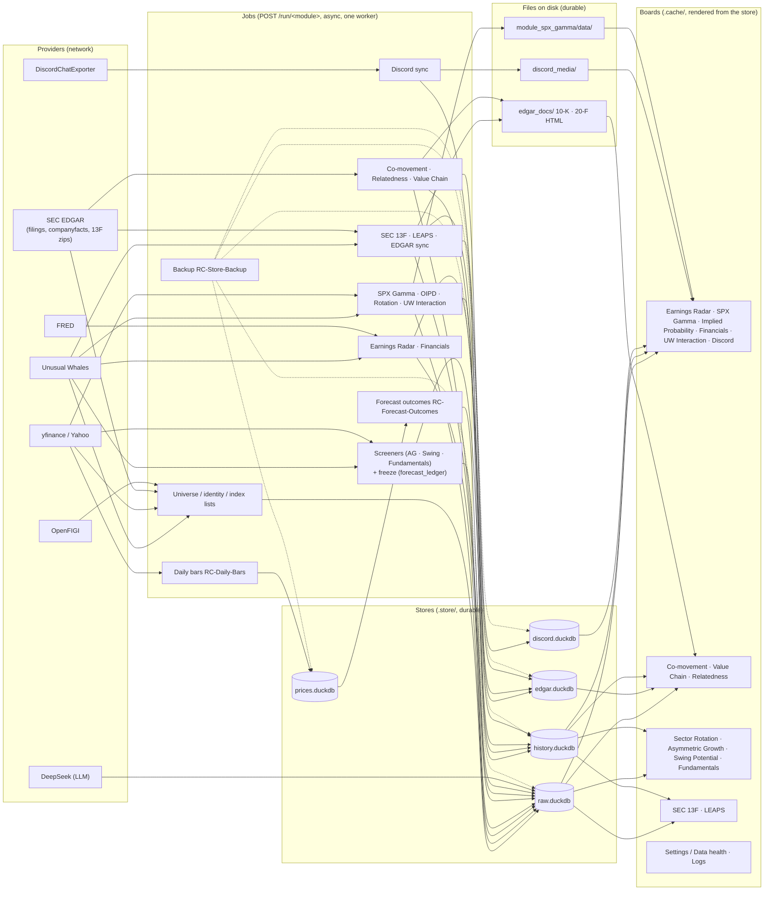

# System map — RevenueChaser

Where each part of the app lives, and how data moves from a provider to a board.
Companions: [`data_architecture.md`](data_architecture.md) for the storage rules
(what is durable and what is regenerable), [`data_retrieval.md`](data_retrieval.md)
for Fetch vs Refresh. Source basis: the current worktree; the stores are the five
DuckDB files of `docs/data_architecture.md` §Storage layout (the fifth,
`history.duckdb`, appears with the first recorded run, `core/history.py`).

## The area map

Every change is filed under one `area:*` label, and the key becomes the branch name
(`area/<key>/<slice>`, [`CLAUDE.md`](../CLAUDE.md) §Tracking and branches). The keys
below are the ones `alsanvolkan/RevenueChaser#45` names; the directories and modules
beside them are read from this tree. The epic column is the pairing this file already
carried (#49–#60, #79). The repository records the label convention but not the key
list or its epic pairing, so treat the pairing as the epics' own naming rather than a
stored fact.

| `area:*` key | What it holds | Directories and main modules | Epic |
|---|---|---|---|
| `platform-store` | The durable store, its writers, migrations and backups | `.store/` (five DuckDB files), `edgar_docs/`, `core/rawstore.py`, `core/config.py`, `core/prices.py`, `core/quotes.py`, `core/history.py`, `core/automations.py`, `scripts/backup_store.py`, `scripts/restore_store.py`, `scripts/compact_store.py`, `scripts/daily_bars.py`, `scripts/migrate_rawdata_to_duckdb.py` | #49 |
| `platform-app` | The dashboard process: tabs, routes, the job queue, Fetch vs Refresh, logs, the launcher | `app/` (`dashboard.py`, `jobs.py`, `runners.py`, `logview.py`, `launcher.py`), `templates/` (the shell, the logs page, and the empty / error / locked pages), `app/static/`, `core/job_control.py`, `core/job_lock.py`, `launch.pyw`, `run_dashboard.bat`, `start.ps1`, `stop.ps1`, `app.sh` | #50 |
| `providers` | Network clients, and the credential and cost gates in front of them | `core/providers/`, `core/credentials.py`, `core/offpeak.py`, `core/subscription_usage.py`, `scripts/cloud_llm_call.py`, `.env.example`, `docs/openapi.yaml` (the UW endpoint contract) | #51 |
| `classification` | Which sector, industry, theme and index a ticker carries, and the three boards built on that cut | `module_comovement/`, `module_relatedness/`, `module_value_chain/`, `core/universe.py`, `core/universe_fetch.py`, `core/gics_map.py`, `core/taxonomy.py`, `core/index_registry.py` | #55 |
| `market` | Index-greeks, options-probability, sector-rotation and UW-tool boards | `module_spx_gamma/`, `module_oipd/`, `module_sector_rotation/`, `module_uw_interaction/`, `core/models/rotation.py`, `module_financials/` *(unclear — see below)* | #57 |
| `screeners` | Per-ticker scans over the universe | `module_asymmetric_growth/`, `module_swing_potential/`, `module_fundamentals/`, `core/screen_common.py`, `core/scan_quality.py`, `core/tristate.py`, `core/sector_rules.py`, `core/info_fallback.py`, `core/ohlc_cache.py` | #56 |
| `ownership` | 13F holders, and the LEAPS watchlist that reads their meta | `module_sec_13f/`, `module_leaps/`, `core/ownership.py` | #59 |
| `earnings` | The Earnings Radar rules and the stored inputs they read | `module_earnings_radar/`, `core/models/events.py`, `core/nightly_inputs.py`, `core/reaction_anchor.py`, `core/vol_metrics.py`, `scripts/nightly_inputs.py`, `docs/rules/` | #58 |
| `data-health` | The Settings board: coverage, refetch, 10-K freshness, per-board settings | `module_settings/`, `core/board_settings.py`, `docs/data_health.md` | #53 |
| `shared-ui` | The filter kit and the HTML trust boundary every board renders through | `core/reporting_common.py`, `core/html_safe.py`, `core/templating.py`, `core/provenance.py`, `core/funnel.py`, `core/static/`, `docs/dashboard_ui.md` | #54 |
| `quality` | The unit and e2e tiers, their harnesses, and the guards CI runs | `module_testing/` (`e2e/`, `e2e/harness/`), the `tests/` directory beside each package, `core/tests/`, `conftest.py`, `pytest.ini`, `.github/workflows/tests.yml`, `scripts/private_check.py` | #60 |
| `community` | The Discord archive and its board | `module_discord/`, `discord_media/`, `.store/discord.duckdb` | #79 |
| — *(no key)* | The identity spine: every ticker's security type, name and classification sources | `core/identity/` (incl. `sources/`), `core/sic_registry.py`, `core/identity_cusip.py`, `core/company_profile.py`, `scripts/index_lists.py` | #52 |

Two rows the label list does not settle:

- **#52 has no key.** The identity spine is real and substantial: `core/identity/`
  writes `security_master`, and `core/identity/apply.py` applies it to
  `equity_universe`, so the sector names and the universe cut every board filters on
  come out of that chain (`docs/data_architecture.md` §Classification is the SSoT).
  None of the twelve keys names it. Its slices are filed under `classification` when
  they change what a board shows and under `platform-store` when they change a table.
  Which key owns a new identity slice is **unclear**; pick one when you file it.
- **`module_financials/`** is in the `market` row because that is where #57 put it.
  Its subject is the company's own statements (DCF, comps, three-statement, credit
  capacity) over the cached Yahoo/UW payload, so `earnings` is an equally plausible
  home. **Unclear.**

## Where the shared code lives

These files are reached from more than one area. Some already appear in an area row as
their owner — `core/history.py` and `core/prices.py` under `platform-store`,
`core/reporting_common.py`, `core/html_safe.py`, `core/static/`, `core/templating.py`,
`core/provenance.py` and `core/funnel.py` under `shared-ui` — so for those this table
says who *else* reaches for them, and the rest appear only here. The tables and their
writers are `data_architecture.md`'s subject; this is only "who reaches for the file".

| File | Who reaches for it |
|---|---|
| `core/rawstore.py`, `core/config.py` | Every area: the schema manifest, the data roots and the test redirects |
| `core/history.py` | Every board module that has a `history.py` (see the note under the diagram) |
| `core/ledger.py` | The freeze, called from `module_asymmetric_growth/`, `module_swing_potential/`, `module_fundamentals/`, `module_comovement/engine.py`, `module_value_chain/engine.py`, `module_financials/run.py`, the jobs in `app/` (`jobs.py`, `runners.py`, `universe_cli.py`), `core/provenance.py` and `scripts/forecast_outcomes.py` |
| `core/outcomes.py` | `scripts/forecast_outcomes.py` (the `RC-Forecast-Outcomes` task) |
| `core/prices.py` | The daily bars the Asymmetric Growth engine, `module_comovement/`, Sector Rotation's money flow, SEC 13F's enrich step, Settings and the Earnings inputs read; `scripts/daily_bars.py` writes them |
| `core/ticker_store.py` | Written once per Asymmetric Growth scan, by the job rather than the engine (`app/runners.py` calls `write_from_cards` with the scan's cards); read by `app/dashboard.py`, `module_asymmetric_growth/report.py`, `module_earnings_radar/pipeline.py` and `module_financials/engines/quick_remarks_engine.py` |
| `core/provenance.py` | `app/dashboard.py` and the Swing / Fundamentals pipelines (through `core/screen_common.py`); one dispatch entry per board |
| `core/funnel.py` | `module_asymmetric_growth/` and `module_comovement/` (both `engine.py` and `report.py`), `module_swing_potential/report.py`, `module_settings/boards.py`, and `core/screen_common.py` for the Swing / Fundamentals pipelines |
| `core/reporting_common.py` | Every board: the filter kit, the artifact writers, the health banner |
| `core/html_safe.py` | The escape helpers: every `module_*/report.py`, plus `core/funnel.py`, `core/reporting_common.py` and `app/logview.py` |
| `core/static/` | `rc_filters.js` / `rc_filters.css`, read and inlined into every board's page by `core/reporting_common.py` |
| `core/templating.py` | The pages `app/` renders (`dashboard.py`, `logview.py`, `runners.py`) |

## Data flow: providers → jobs → stores → boards

Providers are reached only by the async jobs behind `POST /run/<module>` (one worker drains the queue; a
Refresh re-reads `.store/` with no network). Each job writes its rows to a store file, and the boards
render from the store. Files on the side (`edgar_docs/`, `discord_media/`, the SPX Gamma tree) hold the
artifacts that are files intrinsically; `.cache/` holds the regenerable board output.

Notes the diagram simplifies:

- **Fetch vs Refresh.** A Fetch runs a job (network) and re-caches the board; a Refresh drops the
  `.cache/` artifact and re-derives the board from `.store/` with no network at all
  (`docs/data_retrieval.md`). The boards above are the `.cache/*_latest.html` artifacts.
- **Result history.** `core/history.record_run` writes one header row and its run-keyed rows to
  `history.duckdb` per run; the "Recorded sessions" block reads them (`core/reporting_common.py`).
  The file appears with the first recorded run. Every board module except `module_spx_gamma`,
  `module_uw_interaction`, `module_settings` and `module_discord` has a `history.py` that calls it;
  Discord records its own export runs in its own store, and the other three record nothing.
- **The forecast ledger.** `core/ledger.py` freezes each board's shown picks into
  `raw.duckdb.forecast_ledger` (append-only, `"history": True`, #286); `core/outcomes.py` derives
  `forecast_outcomes` from it and the `prices.duckdb` bars.
- **Credentials and providers.** Provider base URLs are env-overridable and their key messages live in
  `core/credentials.py`; the job queue and its `X-RC-Panel` CSRF rule are in `app/jobs.py` and
  `app/dashboard.py`.

## Documents by area

The reference documents in this tree, by the area that owns them. **This repository
carries no plan documents**: `git ls-files` matches no path containing `plan`, there is
no `plans/` tree and no `.hermes/` here (work orders live in the private repository,
[`CLAUDE.md`](../CLAUDE.md) §Where work happens), so no plan is indexed below.

| Document | Area | What it is |
|---|---|---|
| [`data_architecture.md`](data_architecture.md) | `platform-store` | The storage contract: `.store/` vs `.cache/`, the per-table schema, migration and backup rules |
| [`data_retrieval.md`](data_retrieval.md) | `platform-app`, `providers` | Fetch vs Refresh, the routes, the credential and base-URL seams |
| [`dashboard_ui.md`](dashboard_ui.md) | `shared-ui` | The filter kit and the searchable ticker picker |
| [`data_health.md`](data_health.md) | `data-health` | Store coverage, refetch and 10-K freshness; the Settings ticker drill |
| [`testing_framework.md`](testing_framework.md) | `quality` | Reading guide to the unit tier: what each module's tests guarantee |
| [`e2e_testing.md`](e2e_testing.md) | `quality` | The end-to-end tier and its harness |
| [`classification_design.md`](classification_design.md) | `classification` | The classification data-model work order (see the note below) |
| [`glossary.md`](glossary.md) | `platform-store`, `classification` | Old → new dataset and field names, kept in step with `rawstore._RENAMES` |
| [`llm_offpeak.md`](llm_offpeak.md) | `providers`, `classification` | The DeepSeek off-peak gate and its USD cap; Relatedness is its only caller |
| [`validation_thinking_vs_nonthinking_50.md`](validation_thinking_vs_nonthinking_50.md) | `classification`, `providers` | One measurement: the thinking flag's effect on the Relatedness profile writer |
| [`rules/00_overview.md`](rules/00_overview.md), [`rules/r2`–`r8`](rules/r2_guidance.md), [`rules/redesign.md`](rules/redesign.md) | `earnings` | The intended rule design (explicitly not a description of what runs) and the rule change log |
| [`openapi.yaml`](openapi.yaml) (not Markdown) | `providers` | The Unusual Whales endpoint contract |
| `system_map.md` | all | This file |

Two of those documents are written **as** work orders. `classification_design.md` calls
itself "the single work order" and names four plan files it supersedes (`plan_rest.md`,
`plan_rest_hardening.md`, `plan_rest_review.md`, `plan_rest_hardening_review.md`) — none
of them is in this tree. `llm_offpeak.md` is titled "Plan" and now records its status as
implemented. Both are indexed above as the reference documents for their area, not as
plans. `classification_design.md`'s reviewer's guide states that `.store/` holds two
DuckDB files, which predates `prices.duckdb` (#156) and `history.duckdb` (#287);
`data_architecture.md` is the contract and wins.

## Misplaced seams

Places where one area reaches into another's, or where a file's directory does not
match its area. **Listed, not fixed**: each is its own change with its own review.
Line numbers are this worktree's.

### A board module reaching into another area

- `module_earnings_radar/pipeline.py:24` imports Sector Rotation's
  `engine.get_quadrant_for_ticker`; `:25` imports LEAPS' `engine.load_cache` — one
  earnings run reads a market board's and an ownership board's computed state.
- `module_earnings_radar/inputs/cftc_cot.py:21` imports `module_spx_gamma.cftc._map_row`
  and `_market_where` — two **private** helpers, and the module docstring says the parse
  is "SPX Gamma's own". **Worth an issue**: either the CFTC parse becomes a shared
  provider-side reader or the two public names are agreed.
- `module_earnings_radar/macro_watch.py:16` imports Sector Rotation's `MACRO_SERIES`,
  while `module_sector_rotation/engine.py:550` imports earnings' `macro_weekly_closes`.
  The two areas import each other. **Worth an issue**: that pair is the FRED/rotation
  seam and it already forced a lazy import.
- `module_earnings_radar/report.py:1578` imports Sector Rotation's `ROTATION_ETFS` with
  the comment "lazy: no import cycle" — the same list, the same cycle, a third reader.
- `module_relatedness/themes.py:1038` — a classification module imports Sector
  Rotation's `ROTATION_ETFS`. Same list again (see the `ROTATION_ETFS` entry below).
- `module_asymmetric_growth/engine.py:842` — a screener imports
  `module_sec_13f.engine`. **Worth an issue** only if the two are meant to stay
  independent; today an AG run cannot be reasoned about without the 13F store.
- `module_financials/engines/quick_remarks_engine.py:51` calls the AG screener's
  `score_ticker`. Cross-board *computation*, not just a data read — **worth an issue**
  as the clearest case of one board computing another's score.
- `module_settings/boards.py:15–18` imports Co-movement's and Swing's `config`/`settings`;
  `module_settings/inventory.py:21` imports Discord's `readiness`, `:397` Sector
  Rotation's `etf_holdings`, `:938` Value Chain's `engine`. Settings is the board that
  has to know every other board, so this one is structural rather than accidental —
  **not worth its own issue**, but it is why `module_settings` changes so often.

### `core/` reaching into a board

- `core/taxonomy.py:12` and `core/prices.py:31` import
  `module_sector_rotation.universe.ROTATION_ETFS`. Core is the layer every module may
  import; here it imports a market board, so the boards' import graph is no longer a
  tree. **Worth an issue**: the fix is the `ROTATION_ETFS` move below, which removes
  both edges.
- `core/taxonomy.py:138,147` import `module_relatedness.themes` — a classification
  board, reached from the theme SSoT.
- `core/board_settings.py:51,59` import `module_comovement.config`/`ohlc` and `:113`
  imports `module_swing_potential.config`; `core/provenance.py:61` imports
  `module_comovement.ohlc`. Both files are registries that have to name a board's module
  to describe it (the Settings knobs, the board's source table), so this is the price of
  a per-board registry in `core/` and it is why a new board touches `core/`. **Not worth
  its own issue.**
- `scripts/backup_store.py:886` imports `module_spx_gamma.config` for the SPX tree's
  path. Small; fold it into whichever change next touches the backup — **not worth its
  own issue**.
- `core/vendor_data.py:36` imports `core.ownership` (both are writers, different areas:
  vendor statements vs the ownership snapshot). Core-to-core, so cheaper than the
  above, but the same shape. **Not worth its own issue.**

### `ROTATION_ETFS` — a list that is not a board's

`module_sector_rotation/universe.py` holds `ROTATION_ETFS`, imported by
`core/taxonomy.py`, `core/prices.py`, `module_relatedness/themes.py`,
`module_earnings_radar/report.py`, `module_sector_rotation/history.py` and
`app/runners.py`. The ETF list is reference data; its current home is a board module.
**Worth an issue**: moving it removes four cross-area edges, two of them from inside
`core/`, and `MACRO_SERIES` — the earnings ↔ rotation pair above — sits in the same
file.

### A file whose directory is not its area

- `core/models/events.py` is imported only by `module_earnings_radar/`;
  `core/models/rotation.py` only by `module_sector_rotation/`. **Worth an issue**: one
  board's models in the shared package.
- `core/vol_metrics.py` (Earnings Radar) and `core/reaction_anchor.py` (Earnings Radar)
  are single-board files in `core/`. `core/gex_profile.py` is shared by Earnings Radar
  and SPX Gamma — two areas, one file.
- `core/screen_common.py` (Swing + Fundamentals), `core/scan_quality.py` (the three
  screeners, and `app/dashboard.py`), `core/tristate.py` (the three screeners), `core/sector_rules.py`
  (Asymmetric Growth), `core/info_fallback.py` (Asymmetric Growth + Swing) and
  `core/ohlc_cache.py` (`module_swing_potential/indicators.py` is its only reader) are
  the screeners' machinery kept in `core/`. **Worth an issue** as one move, not six.
- `app/universe_cli.py` is the universe-refresh CLI living in the app shell while the
  universe belongs to `classification` (`core/universe_fetch.py`). **Not worth its own
  issue**; fold it into the next universe change.

### One row of this map changed as a result

`core/ledger.py` and `core/outcomes.py` were listed under `screeners` in the older
version of the area table. They are shared — the ledger is the freeze used by three
areas' boards, and `outcomes` is derived by `scripts/forecast_outcomes.py` — so they are
in §Where the shared code lives instead. `core/screen_common.py` likewise moved out of
`shared-ui`: it is a scan skeleton, not UI.

### Checked, and not seams

- `app/dashboard.py` and `app/runners.py` import every `module_*` by design: they are
  the composition root (`docs/data_retrieval.md`).
- Imports inside one area stay inside it: Co-movement ↔ Relatedness ↔ Value Chain,
  SEC 13F ↔ LEAPS, Swing ↔ Fundamentals.
- `main.py` at the root is the legacy Earnings Radar CLI that `./app.sh menu` and
  `./app.sh radar` run; it imports earnings and rotation the way the dashboard does.
- `conftest.py:184` imports `module_discord.exporter` to switch its CLI off in tests —
  the test harness, not a board.
- `docs/`, `.github/`, `.claude/` and `templates/` hold no code that belongs to another
  area except the dealer-hedge template and `app/universe_cli.py`, both noted above.

